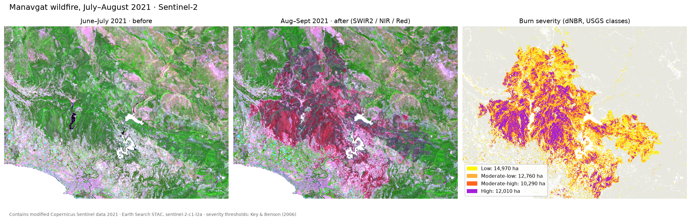
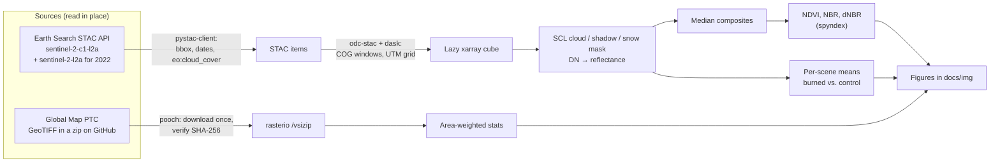
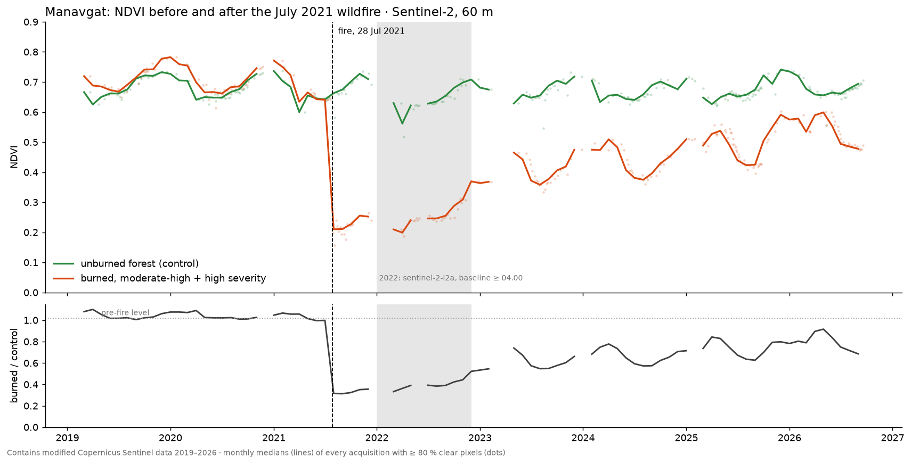

# remote_sensing

[](requirements.txt)
[](LICENSE)

**Satellite imagery with Python, from a global forest map to one forest fire: Sentinel-2 searched through STAC, loaded lazily with odc-stac, cloud-masked and turned into burn severity and five years of recovery. No downloads by hand, no account, no GPU.**



Three notebooks, each runnable in Colab or locally, rewritten in 2026 from the original 2023–2024 versions (kept in [`legacy/`](legacy/)).

## Notebooks

| # | Notebook | What it does | Runtime* |
|---|---|---|---|
| 01 | [The World's Forests](notebooks/01_world_forests.ipynb) [](https://colab.research.google.com/github/oechenique/remote_sensing/blob/main/notebooks/01_world_forests.ipynb) | Global percent tree cover (Global Map, ~1 km): map, area-weighted statistics and a latitude profile | ~30 s |
| 02 | [Sentinel-2 over Antalya with STAC](notebooks/02_sentinel2_stac.ipynb) [](https://colab.research.google.com/github/oechenique/remote_sensing/blob/main/notebooks/02_sentinel2_stac.ipynb) | STAC search, lazy loading, SCL cloud mask, monthly clear-sky composite, true colour and NDVI | ~1 min |
| 03 | [Manavgat 2021: burn severity and recovery](notebooks/03_manavgat_burn_ndvi.ipynb) [](https://colab.research.google.com/github/oechenique/remote_sensing/blob/main/notebooks/03_manavgat_burn_ndvi.ipynb) | dNBR burn severity in hectares and a 2019–2026 NDVI time series, burned vs. unburned control | ~5 min |

\* Measured on a laptop over home broadband; it depends mostly on the network.

## How it works



Nothing heavy is stored in the repo. Sentinel-2 pixels are streamed from Cloud-Optimized GeoTIFFs on AWS, and only the windows and overview levels each notebook needs are read. The 80 MB Global Map zip is downloaded once into a git-ignored `data/` folder and checked against its hash.

## What it shows

- **Manavgat burned ~50,000 ha; 22,300 ha at moderate-high or high severity.** dNBR from 17 pre-fire and 14 post-fire scenes, at 20 m, classified with the USGS thresholds (Key & Benson 2006) ([notebook 03](notebooks/03_manavgat_burn_ndvi.ipynb)).
- **Five years later the burned forest has closed 60 % of the gap.** Summer NDVI of the severely burned area was 0.67 before the fire, 0.21 right after it and 0.49 in 2026. Relative to an unburned control: 102 % → 32 % → 73 %, recovering every year (39 % in 2022, 56 % in 2023, 59 %, 66 %, 73 %). That comes from 722 scenes, 258 of them clear enough over both areas.
- **A monthly composite beats "the first scene"**: on 2023-12-02, the scene the 2024 notebook plotted, only 31 % of the Antalya box was clear; the December median composite has a clear value for virtually every pixel (100.0 % rounded) ([notebook 02](notebooks/02_sentinel2_stac.ipynb)).
- **23 % of the land north of 60°S is under tree canopy** (30.0 of 132.8 million km²), and 39 % has at least 10 % cover. The equatorial band averages 54 % cover against 14 % in the 20–35°N dry belt. Every figure is area-weighted ([notebook 01](notebooks/01_world_forests.ipynb)).



## Decisions and what I learned

- **Collection 1, not the old collection.** Earth Search's `sentinel-2-c1-l2a` is the archive reprocessed with the 05.xx baselines, so 2019 and 2026 pixels are comparable. The old `sentinel-2-l2a` mixes baselines from 02.xx to 05.xx.
- **The 2022 hole.** Over Manavgat, Collection 1 has 10 scenes in all of 2022 against ~170 in the old collection, right in the first year of recovery. The gap is filled from `sentinel-2-l2a` (baseline ≥ 04.00).
- **Metadata that lies.** The old collection's `raster:bands` says `offset: -0.1`, but its COGs are already harmonized. The same scene differs by ~1000 DN between collections, checked on every 2022 date available in both. Following the metadata subtracted the offset twice: the control forest vanished (dark pixels went to ≤ 0) and NDVI jumped. The 2022 scenes now use DN × 0.0001.
- **Shadows are not clouds.** Dropping SCL class 2 (*dark area / topographic shadow*) left permanent holes in the December composite: the north-facing slopes of the Taurus are in shadow on every winter day. Class 2 is kept; snow (class 11) is dropped from the NDVI series.
- **Ratio to a control.** Raw NDVI swings with seasons and dry years. Dividing by unburned forest nearby isolates the fire.
- **Pixels on a lat/lon grid are not equal.** A 30″ pixel at 60°N covers half the ground of one at the equator; counting pixels would overweight boreal forests.
- **`/vsizip` + `pooch`** instead of a committed 87 MB GeoTIFF: GDAL reads the TIFF inside the zip, and the hash guarantees the file is the expected one.

## Limits and what I'd do next

- The burn statistics use a bounding box, not the official perimeter. The *Low* class also catches some farmland harvested between the two windows, so 50,000 ha is an upper bound. Next: clip to the EFFIS perimeter.
- NDVI measures greenness, not forest. Shrubs and grass green up long before pines grow back; canopy height (GEDI) or SAR would tell them apart.
- Global Map PTC is a ~2003 baseline at ~1 km. For a current, finer picture: ESA WorldCover (10 m) or Hansen Global Forest Change.
- A geospatial foundation model (Prithvi, Clay, TerraMind) could segment burn scars, but it needs `torch` and in practice a GPU. Here dNBR answers the same question and stays explainable.

## Stack

| Layer | Tools |
|---|---|
| Catalog | STAC API (Earth Search v1, Element 84), `pystac-client` |
| Loading | `odc-stac`, `rasterio` / GDAL (`/vsizip`, COGs), `dask`, `xarray` |
| Analysis | `numpy`, `pandas`, `spyndex` (Awesome Spectral Indices) |
| Data management | `pooch` (cached, hash-verified download) |
| Figures | `matplotlib` |

## Repository layout

| Path | Contents |
|---|---|
| `notebooks/` | The three notebooks, with their key figures as outputs |
| `docs/img/` | Figures exported by the notebooks (used in this README) |
| `legacy/` | The original 2023–2024 notebooks, untouched, with a note on what changed |
| `Notebook/` | Stubs at the old paths, so links shared before 2026 still lead somewhere |
| `requirements.txt` | Pinned environment for running locally |

## Run it

**Colab:** click a badge above. The first cell installs the few packages Colab lacks.

**Locally** (tested with Python 3.12.10 on Windows 11):

```bash
git clone https://github.com/oechenique/remote_sensing.git
cd remote_sensing
python -m venv .venv
.venv/Scripts/python -m pip install -r requirements.txt   # Linux/macOS: .venv/bin/python
.venv/Scripts/python -m jupyter lab notebooks/
```

No credentials are needed: Earth Search and the Sentinel-2 COGs are public.

## Licenses and attribution

- **Code:** [MIT](LICENSE).
- **Global Map – Percent Tree Cover:** *Vegetation (Percent Tree Cover) - Global version - Version 1 © Geospatial Information Authority of Japan, Chiba University and Collaborating Organizations.* The data source and copyright must be shown on any product that uses it ([globalmaps/gm_ve_v1](https://github.com/globalmaps/gm_ve_v1)).
- **Sentinel-2:** Contains modified Copernicus Sentinel data 2019–2026, under the [Copernicus data licence](https://sentinels.copernicus.eu/documents/247904/690755/Sentinel_Data_Legal_Notice), accessed through [Earth Search](https://element84.com/earth-search/) (Element 84) on the AWS Registry of Open Data.
- **Spectral index definitions:** [Awesome Spectral Indices](https://github.com/awesome-spectral-indices/awesome-spectral-indices) via `spyndex`.
- **Burn severity thresholds:** Key, C. H. & Benson, N. C. (2006). *Landscape Assessment (LA)*. FIREMON: Fire Effects Monitoring and Inventory System, USDA Forest Service, RMRS-GTR-164-CD.

---

## Resumen en español

Teledetección con Python en tres notebooks que corren en Colab o en local, sin bajar imágenes a mano, sin cuenta y sin GPU:

1. **Bosques del mundo**: el mapa de cobertura arbórea de Global Map (~1 km) con estadísticas ponderadas por área. El 23 % de la tierra al norte de 60°S está bajo copa.
2. **Sentinel-2 sobre Antalya por STAC**: búsqueda con `pystac-client`, carga lazy con `odc-stac`, máscara de nubes con SCL, compuesto mensual sin nubes y NDVI con `spyndex`.
3. **Incendio de Manavgat (2021)**: severidad con dNBR (~50.000 ha quemadas, 22.300 de severidad alta o moderada-alta) y la recuperación 2019–2026. Cinco años después el bosque quemado recuperó el 60 % de la diferencia con un bosque sano de control.

Lo más interesante del camino: la Collection 1 de Sentinel-2 casi no tiene 2022 en esa zona. Además, la colección vieja que llena el hueco publica un offset en su metadata que sus píxeles ya no tienen; aplicarlo deformaba la serie. Los notebooks originales de 2023–2024 quedan en `legacy/`.
